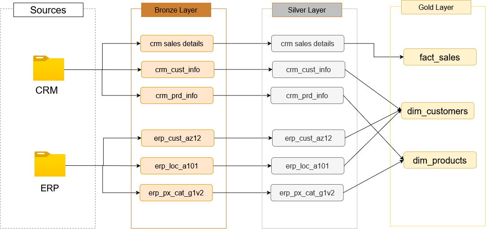

## Data Warehouse and Analytics Project
Welcome to the Data Warehouse Project repository! 🚀
# SQL Data Warehouse Project
Building a modern data warehouse with **SQL Server**, using **ETL processes** and **data modeling** to turn raw source data into analytics-ready tables.
## 🏗️ Architecture

The data warehouse follows the Medallion Architecture with three layers:

1. **Bronze Layer**: Stores raw data as-is from the source systems. Data is ingested from CSV files into the SQL Server database.
2. **Silver Layer**: Handles data cleansing, standardization, and normalization to prepare the data for analysis.
3. **Gold Layer**: Houses business-ready data modeled into a star schema for reporting and analytics.

## 🔄 Data Flow

## 👤 Author

**chaibimad**

- GitHub: [@chaibimad](https://github.com/chaibimad)
- LinkedIn: [imad chaib](https://www.linkedin.com/in/imadchaib/)
