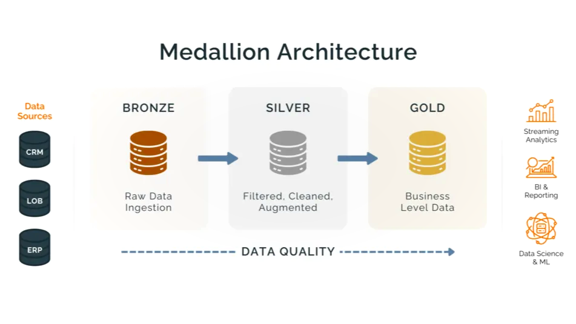

## Data Warehouse and Analytics Project
Welcome to the Data Warehouse Project repository! 🚀
# SQL Data Warehouse Project
Building a modern data warehouse with **SQL Server**, using **ETL processes** and **data modeling** to turn raw source data into analytics-ready tables.
## 🏗️ Architecture

The data warehouse follows the Medallion Architecture with three layers:

1. **Bronze Layer**: Stores raw data as-is from the source systems. Data is ingested from CSV files into the SQL Server database.
2. **Silver Layer**: Handles data cleansing, standardization, and normalization to prepare the data for analysis.
3. **Gold Layer**: Houses business-ready data modeled into a star schema for reporting and analytics.

## 🔄 Data Flow

## 📖 Project Overview

This project involves:

1. **Data Architecture**: Designing a modern data warehouse using the Medallion Architecture with **Bronze**, **Silver**, and **Gold** layers.
2. **ETL Pipelines**: Extracting, transforming, and loading data from source systems into the warehouse.
3. **Data Modeling**: Developing fact and dimension tables optimized for analytical queries.
4. **Analytics & Reporting**: Creating SQL-based reports and dashboards for actionable insights.

## 🌟 About Me

Hi, I'm **imad**, a Master's student in  **Digital Sciences and Artificial Intelligence** . I'm passionate about data and data engineering, and I enjoy building pipelines, modeling data, and turning raw data into useful insights.

This project is part of my learning journey in data warehousing with SQL Server, ETL, and data modeling.

- GitHub: [@chaibimad](https://github.com/chaibimad)
- LinkedIn: [ imad ](https://www.linkedin.com/in/imadchaib/)
